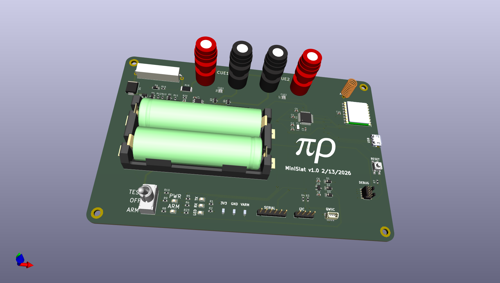
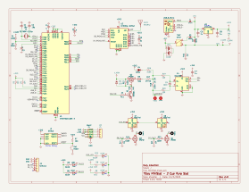

# MiniSlat - 2 cue pyro slat

This is an ARM Cortex M0 board with:
* SAMD21 cpu
* USB for programming & serial debug
* Cortex Debug connector for bootloader install & hw debug
* 2 Pairs of PyroClips (2 cues)
* 915MHz HopeRF RFM95 Lora module
* 2S 18650 LiPo supply (two cells in series) with safe/armed power switch
* INA219 current sensing for continuity test & fire monitoring
* 2 NeoPixels as per-cue status indicators
* I2C expansion (QWIIC connector & 4-pin header)

See [SOFTWARE_SPEC.md](SOFTWARE_SPEC.md) for pin assignments, I2C addresses, and firmware requirements.

[Schematic pdf](v1.0/MiniSlat.pdf)
